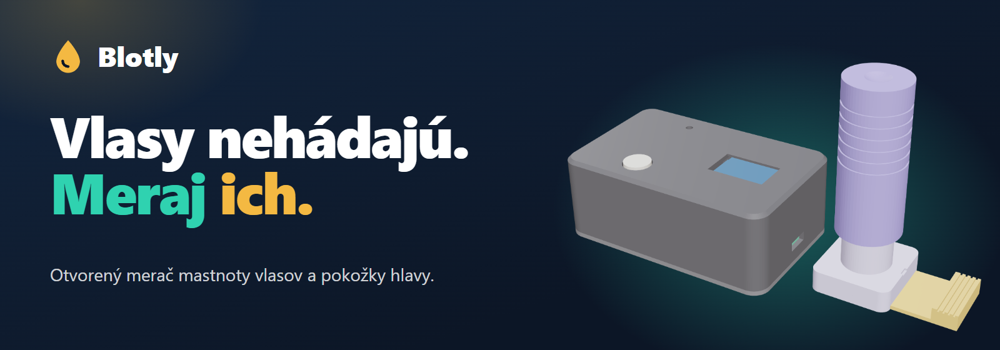

---
# 🧩 Versioning – systém dopĺňa automaticky
fm_version: "1.0.1"

# Dátum buildu – generuje skript
fm_build: "2026-11-02T15:50:50.533120+00:00"

# Poznámka k verzii – voliteľné
fm_version_comment: ""

# 🆔 IDENTITY --------------------------------------------------------

# ID generuje CLI / skript
id: "PRJ-123-Blotly"

# Unikátne UUID – generuje skript
guid: "e7e329f3-b919-40df-be97-2f8ce48416b3"

# 🧭 CONTEXT ---------------------------------------------------------

# DAO / doména (knife, sdlc, q12, 7ds...) dopĺňa skript
dao: "sthdf"

# Názov zápisu – dopĺňa používateľ
title: "PRJ-123 Blotly"

# Krátky popis – dopĺňa používateľ (voliteľné)
description: "Blotly – otvorený merač mastnoty vlasov a pokožky hlavy"

# 👥 AUTHORSHIP ------------------------------------------------------

# Hlavný autor – z globálneho configu
author: "Viliam Vachan"

# Zoznam autorov – generuje skript
authors:
  - "Viliam Vachan"
  - "Tomáš Majerník"

# 🗂 CLASSIFICATION ---------------------------------------------------

# Nadradená kategória – môže doplniť používateľ
category: ""

# Typ dokumentu (guide, case, tutorial...) – používateľ (voliteľné)
type: ""

# Priorita (low/medium/high) – voliteľné
priority: ""

# Tagy – odporúča sa 2–6 tagov.
# Typy tagov:
#   - rámce: knife, 7ds, sdlc, q12
#   - účel: tutorial, guide, pattern, case-study
#   - téma: git, backup, ai, communication
#   - úroveň: beginner, intermediate, advanced
tags: []

# 🌍 LOCALIZATION -----------------------------------------------------

# Jazyk dokumentu – doplní skript podľa štruktúry
locale: "sk"

# 🕒 LIFECYCLE --------------------------------------------------------

# Dátum vytvorenia – generuje skript
created: "2026-11-02 16:50"

# Dátum poslednej úpravy – dopĺňa človek
modified: "2026-11-02 18:30"

# Stav dokumentu – default "backlog"
status: "in-progress"

# Viditeľnosť – default "public"
privacy: "public"

# ⚖ INTELLECTUAL PROPERTY -------------------------------------------

# Držiteľ práv k obsahu – dopĺňa skript
rights_holder_content: "Viliam Vachan, Tomáš Majerník"

# Systémový vlastník práv
rights_holder_system: "CAA / KNIFE / LetItGrow"

# Licencia
license: "CC-BY-NC-SA-4.0"

# Disclaimer
disclaimer: "Use at your own risk. Methods provided as-is; participation is voluntary and context-aware."

# Copyright
copyright: "© 2025 Roman Kazicka"

# 🔗 ORIGIN / PROVENANCE ---------------------------------------------

# Repozitár pôvodu
origin_repo: ""

# URL pôvodného repozitára
origin_repo_url: ""

# Commit pôvodu
origin_commit: ""

# Branch pôvodu
origin_branch: ""

# Systém pôvodu (CAA/KNIFE/STHDF…)
origin_system: "CAA"

# Pôvodný autor
origin_author: "Roman Kazicka"

# Importovaný zdroj
origin_imported_from: ""

# Dátum importu
origin_import_date: ""

# 🧱 RESERVED ---------------------------------------------------------

fm_reserved1: ""
fm_reserved2: ""
---

# PRJ-123 — Overview

**Blotly — Vlasy nehádajú. Meraj ich.**

*Viliam Vachan (ST048), Tomáš Majerník (ST039)*

Blotly je otvorený merač mastnoty vlasov a pokožky hlavy. Zmatňujúci papierik nasaje maz, biela LED ho presvieti a svetelný senzor zmeria, koľko svetla prešlo. Čím mastnejší papierik, tým viac svetla, a výsledok sa zobrazí na OLED displeji. Skrinku aj odberník vzorky si môže každý vytlačiť na 3D tlačiarni a elektroniku zložiť z bežne dostupných súčiastok (orientačne ~30 €).

- [Prezentácia / Slides](./presentation/index.md)
- [Plagát projektu (PDF)](https://github.com/Vilvac003/PRJ-123-Blotly/blob/main/poster/blotly.pdf)
- [SDLC – vývoj podľa fáz](./projects/sdlc/index.md)
- [Študentské deliverables](./students/index.md)
- [3D model a zdrojový kód](https://github.com/Vilvac003/PRJ-123-Blotly/tree/main/hardware)
- [GitHub repozitár](https://github.com/Vilvac003/PRJ-123-Blotly)
