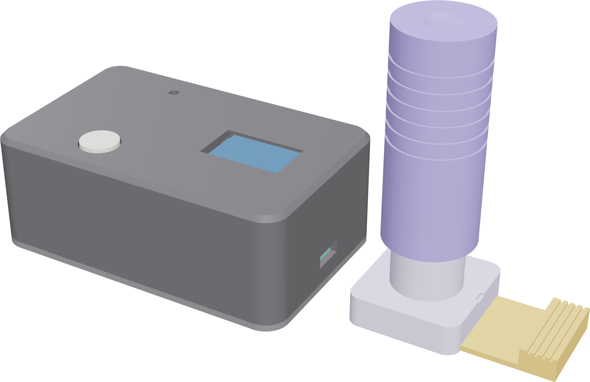
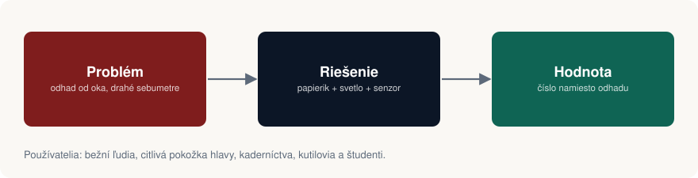
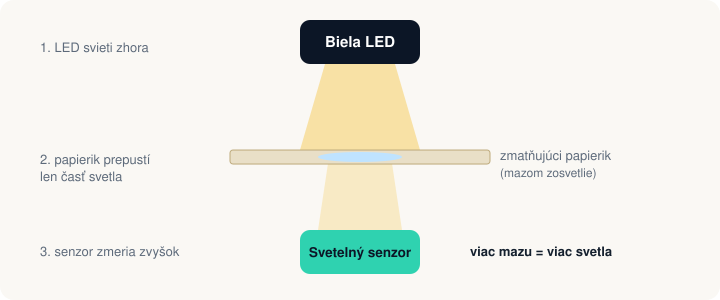
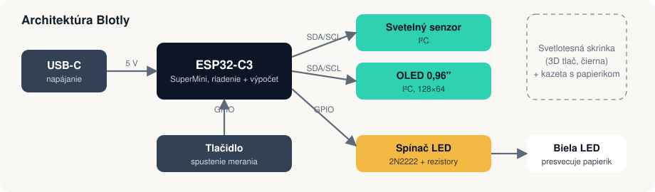
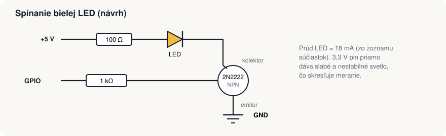
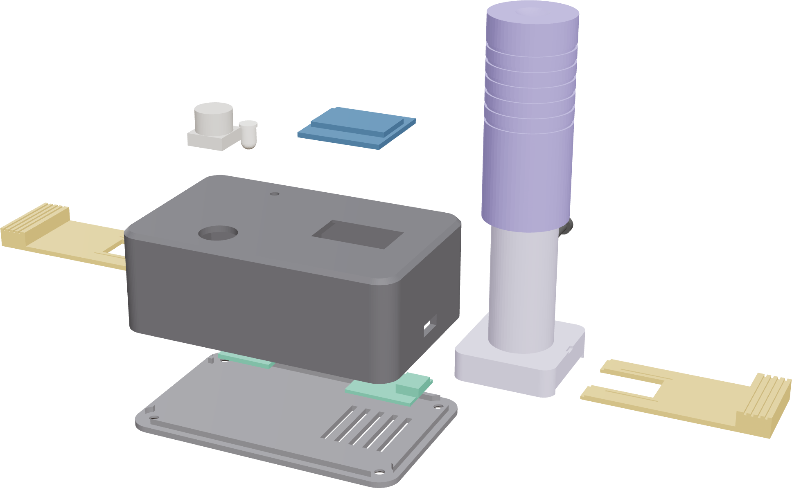
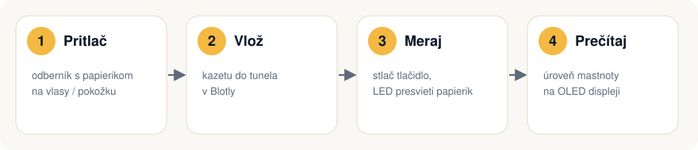
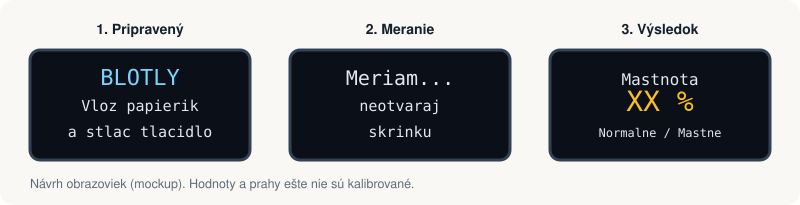
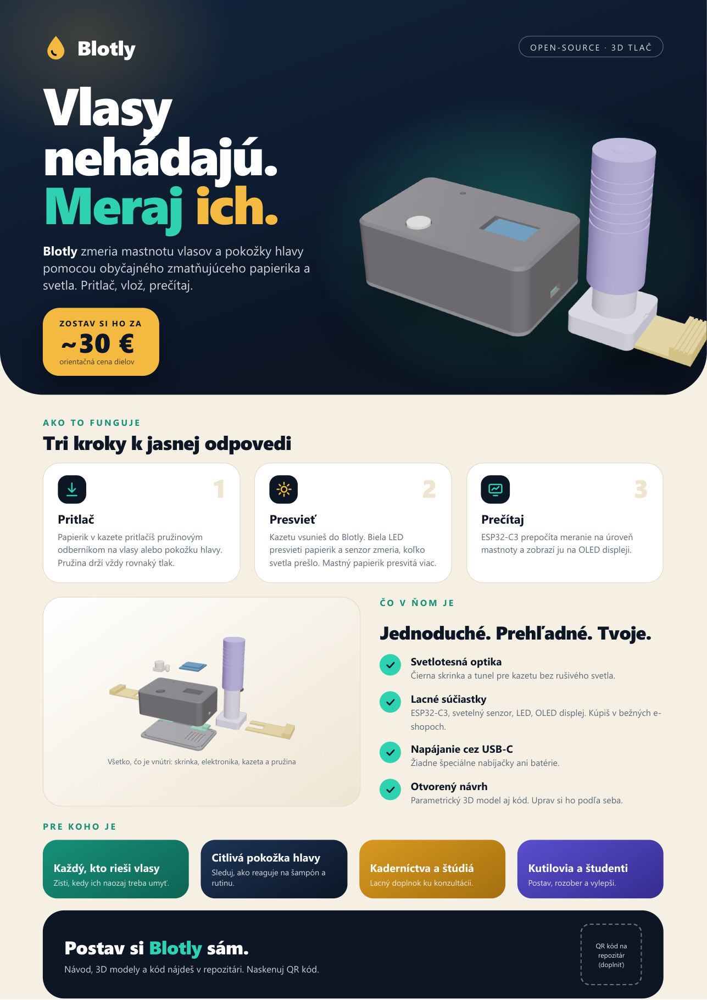

---
# 🧩 Versioning – systém dopĺňa automaticky
fm_version: "1.0.1"

# Dátum buildu – generuje skript
fm_build: "2026-11-02T15:50:53.520344+00:00"

# Poznámka k verzii – voliteľné
fm_version_comment: ""

# 🆔 IDENTITY --------------------------------------------------------

# ID generuje CLI / skript

# Unikátne UUID – generuje skript
guid: "c0762a6d-0726-4b7b-972e-6e961402a567"

# 🧭 CONTEXT ---------------------------------------------------------

# DAO / doména (knife, sdlc, q12, 7ds...) dopĺňa skript
dao: "sthdf"

# Názov zápisu – dopĺňa používateľ
title: "Prezentácia / Slides"

# Krátky popis – dopĺňa používateľ (voliteľné)
description: "Prezentácia projektu Blotly"

# 👥 AUTHORSHIP ------------------------------------------------------

# Hlavný autor – z globálneho configu
author: "Viliam Vachan"

# Zoznam autorov – generuje skript
authors:
  - "Viliam Vachan"
  - "Tomáš Majerník"

# 🗂 CLASSIFICATION ---------------------------------------------------

# Nadradená kategória – môže doplniť používateľ
category: ""

# Typ dokumentu (guide, case, tutorial...) – používateľ (voliteľné)
type: ""

# Priorita (low/medium/high) – voliteľné
priority: ""

# Tagy – odporúča sa 2–6 tagov.
# Typy tagov:
#   - rámce: knife, 7ds, sdlc, q12
#   - účel: tutorial, guide, pattern, case-study
#   - téma: git, backup, ai, communication
#   - úroveň: beginner, intermediate, advanced
tags: ["sthdf","blotly"]

# 🌍 LOCALIZATION -----------------------------------------------------

# Jazyk dokumentu – doplní skript podľa štruktúry
locale: "sk"

# 🕒 LIFECYCLE --------------------------------------------------------

# Dátum vytvorenia – generuje skript
created: "2026-11-02 18:30"

# Dátum poslednej úpravy – dopĺňa človek
modified: "2026-11-02 18:30"

# Stav dokumentu – default "backlog"
status: "in-progress"

# Viditeľnosť – default "public"
privacy: "public"

# ⚖ INTELLECTUAL PROPERTY -------------------------------------------

# Držiteľ práv k obsahu – dopĺňa skript
rights_holder_content: "Viliam Vachan"

# Systémový vlastník práv
rights_holder_system: "CAA / KNIFE / LetItGrow"

# Licencia
license: "CC-BY-NC-SA-4.0"

# Disclaimer
disclaimer: "Use at your own risk. Methods provided as-is; participation is voluntary and context-aware."

# Copyright
copyright: "© 2025 Roman Kazicka"

# 🔗 ORIGIN / PROVENANCE ---------------------------------------------

# Repozitár pôvodu
origin_repo: ""

# URL pôvodného repozitára
origin_repo_url: ""

# Commit pôvodu
origin_commit: ""

# Branch pôvodu
origin_branch: ""

# Systém pôvodu (CAA/KNIFE/STHDF…)
origin_system: "CAA"

# Pôvodný autor
origin_author: "Roman Kazicka"

# Importovaný zdroj
origin_imported_from: ""

# Dátum importu
origin_import_date: ""

# 🧱 RESERVED ---------------------------------------------------------

fm_reserved1: ""
fm_reserved2: ""
---

<!-- SDLC_INSTANCE_ID: PRJ-123-Blotly -->

# PRJ-123 — Presentation

## Blotly — Vlasy nehádajú. Meraj ich.

*Stav k 2. 11. 2026: návrh a 3D model sú hotové, prototyp sa zostavuje. Miesta označené TODO doplníme po zostavení a testoch.*

## Popis riešenia

Mastnotu vlasov dnes posudzujeme od oka a profesionálne sebumetre (napr. Sebumeter SM 815) sú pre bežného človeka drahé. **Blotly** zopakuje ich princíp lacno a otvorene: zmatňujúci papierik odoberie z vlasov maz a stane sa priesvitným, LED ho presvieti a svetelný senzor zmeria prejdené svetlo.

## Súčiastky

| Časť | Súčiastka | Orientačná cena |
|------|-----------|-----------------|
| Riadenie | ESP32-C3 SuperMini (záložný kus ~5,90 €) | TODO |
| Senzor | digitálny svetelný senzor I²C (BH1750 / TSL2591) | TODO |
| Displej | OLED 0,96″ 128×64 I²C (LaskaKit) | 5,25 € |
| Osvetlenie | biela LED 5 mm, 3 mm stavová LED | TODO |
| Spínanie LED | tranzistor 2N2222 ×2 | 0,05 €/ks |
| Rezistory | sada 30 hodnôt × 20 ks (100 Ω, 330 Ω, 1 kΩ) | 2,90 € |
| Prepojenie | breadboard 830 (1,60 €), prepojovacie káble (2,20 €) | 3,80 € |
| Ovládanie | tlačidlo 12×12×4,3 mm | 0,08 € |
| Mechanika | tlačná pružina 0,8×8,3×60 mm (Ložiská ELM) | 1,08 € + poštovné |
| Spotrebný materiál | zmatňujúce papieriky (Notino) | 2,40 € |
| Skrutky | 4× M3×8 (veko), 1× M3×10 (čap odberníka) | v železiarstve |
| 3D tlač | čierny PLA alebo PETG | podľa tlačiarne |

*Ceny sú z nákupného zoznamu a sú orientačné. Poštovné sa pripočítava zvlášť.*

## Analýza a počiatočný návrh

Porovnali sme tri spôsoby merania mastnoty:

| Princíp | Náročnosť | Presnosť | Spotrebný materiál |
|---------|-----------|----------|--------------------|
| **Optický** (papierik + LED + senzor) | stredná | vysoká, najspoľahlivejší na tuk | áno (papieriky) |
| Kapacitný / odporový (elektródy) | nízka | nízka až stredná, ruší ho pot a vlhkosť | nie |
| Kamerový (mikroskop + softvér) | vysoká | stredná, dobré na vizualizáciu | nie |

Zvolili sme **optický princíp**, lebo je najbližšie profesionálnym prístrojom a dá sa postaviť lacno.

## Návrh

### Princíp merania

### Architektúra

ESP32-C3 riadi všetko: cez I²C komunikuje so svetelným senzorom a OLED displejom, cez GPIO spína LED a číta tlačidlo. LED je spínaná tranzistorom 2N2222, aby svietila stabilne zo 5 V.

### Konštrukcia

Všetky diely sú parametricky modelované v Pythone ([`hardware/model.py`](https://github.com/Vilvac003/PRJ-123-Blotly/blob/main/hardware/model.py)) a tlačia sa z PLA alebo PETG. Skrinka a kazeta sú **čierne**, aby optika zostala svetlotesná.

| Diel | Účel |
|------|------|
| `base_body` (95×60×34 mm) | skrinka s optickým tunelom, otvormi pre OLED, tlačidlo a USB-C |
| `base_plate` | spodné veko na 4 skrutky M3 |
| `cassette` (26×56 mm) | nosič papierika s oknom 12×12 mm |
| `sampler_sleeve`, `sampler_piston` | pružinový odberník, ktorý pritlačí kazetu s rovnakým tlakom |

3D súbory: [STL na tlač](https://github.com/Vilvac003/PRJ-123-Blotly/tree/main/hardware/stl), [GLB náhľady](https://github.com/Vilvac003/PRJ-123-Blotly/tree/main/hardware/glb).

## Verzovanie a workflow

- Zdrojový kód a modely sú v GitHub repozitári [https://github.com/Vilvac003/PRJ-123-Blotly](https://github.com/Vilvac003/PRJ-123-Blotly).
- Dokumentácia je v Markdowne a publikuje sa cez Docusaurus.
- 3D model je generovaný skriptom, takže zmena rozmeru sa premietne do všetkých dielov.

## Používateľská príručka

1. Papierik v kazete pritlačte odberníkom na vlasy alebo pokožku hlavy.
2. Kazetu vsuňte do tunela v Blotly.
3. Stlačte tlačidlo. LED presvieti papierik a senzor zmeria prejdené svetlo.
4. Úroveň mastnoty sa zobrazí na displeji.

## Finálny prototyp

TODO – fotky zostaveného prototypu, video a výsledky prvých meraní.

Zatiaľ je hotový 3D model a plagát:

## Záver a budúci vývoj

- **Hotové:** princíp, 3D model, výber súčiastok, plagát, dokumentácia.
- **Zostáva:** zostavenie prototypu, firmvér, kalibrácia a overenie opakovateľnosti.
- **Nápady do budúcna:** ukladanie histórie meraní, mobilná aplikácia, porovnanie s profesionálnym prístrojom.

---
**Navigation:** [🏠 Home](../index.md) · [SDLC](../projects/sdlc/index.md)
