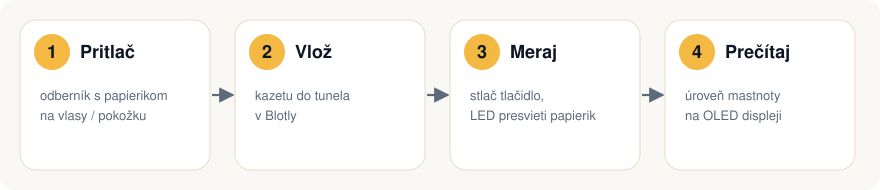
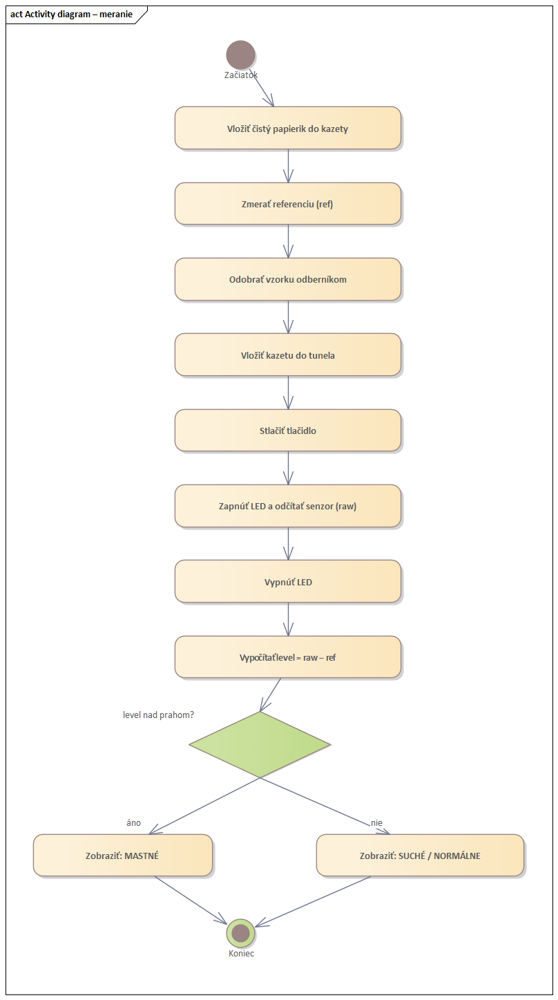

---
# 🧩 Versioning – systém dopĺňa automaticky
fm_version: "1.0.1"

# Dátum buildu – generuje skript
fm_build: "2026-11-02T15:50:53.336688+00:00"

# Poznámka k verzii – voliteľné
fm_version_comment: ""

# 🆔 IDENTITY --------------------------------------------------------

# ID generuje CLI / skript

# Unikátne UUID – generuje skript
guid: "6915fddf-eb37-4d51-b98b-825a2c53a713"

# 🧭 CONTEXT ---------------------------------------------------------

# DAO / doména (knife, sdlc, q12, 7ds...) dopĺňa skript
dao: "sthdf"

# Názov zápisu – dopĺňa používateľ
title: "user guide"

# Krátky popis – dopĺňa používateľ (voliteľné)
description: "Používateľská príručka"

# 👥 AUTHORSHIP ------------------------------------------------------

# Hlavný autor – z globálneho configu
author: "Viliam Vachan"

# Zoznam autorov – generuje skript
authors:
  - "Viliam Vachan"
  - "Tomáš Majerník"

# 🗂 CLASSIFICATION ---------------------------------------------------

# Nadradená kategória – môže doplniť používateľ
category: ""

# Typ dokumentu (guide, case, tutorial...) – používateľ (voliteľné)
type: ""

# Priorita (low/medium/high) – voliteľné
priority: ""

# Tagy – odporúča sa 2–6 tagov.
# Typy tagov:
#   - rámce: knife, 7ds, sdlc, q12
#   - účel: tutorial, guide, pattern, case-study
#   - téma: git, backup, ai, communication
#   - úroveň: beginner, intermediate, advanced
tags: []

# 🌍 LOCALIZATION -----------------------------------------------------

# Jazyk dokumentu – doplní skript podľa štruktúry
locale: "sk"

# 🕒 LIFECYCLE --------------------------------------------------------

# Dátum vytvorenia – generuje skript
created: "2026-11-02 16:50"

# Dátum poslednej úpravy – dopĺňa človek
modified: "2026-11-02 18:30"

# Stav dokumentu – default "backlog"
status: "in-progress"

# Viditeľnosť – default "public"
privacy: "public"

# ⚖ INTELLECTUAL PROPERTY -------------------------------------------

# Držiteľ práv k obsahu – dopĺňa skript
rights_holder_content: "Viliam Vachan, Tomáš Majerník"

# Systémový vlastník práv
rights_holder_system: "CAA / KNIFE / LetItGrow"

# Licencia
license: "CC-BY-NC-SA-4.0"

# Disclaimer
disclaimer: "Use at your own risk. Methods provided as-is; participation is voluntary and context-aware."

# Copyright
copyright: "© 2025 Roman Kazicka"

# 🔗 ORIGIN / PROVENANCE ---------------------------------------------

# Repozitár pôvodu
origin_repo: ""

# URL pôvodného repozitára
origin_repo_url: ""

# Commit pôvodu
origin_commit: ""

# Branch pôvodu
origin_branch: ""

# Systém pôvodu (CAA/KNIFE/STHDF…)
origin_system: "CAA"

# Pôvodný autor
origin_author: "Roman Kazicka"

# Importovaný zdroj
origin_imported_from: ""

# Dátum importu
origin_import_date: ""

# 🧱 RESERVED ---------------------------------------------------------

fm_reserved1: ""
fm_reserved2: ""
---

<!-- SDLC_INSTANCE_ID: PRJ-123-Blotly -->

# 📘 User Guide

1. **Pripravte papierik.** Do kazety vložte čistý zmatňujúci papierik.
2. **Odoberte vzorku.** Odberníkom pritlačte kazetu na vlasy alebo pokožku hlavy.
3. **Vložte kazetu.** Zasuňte ju do tunela na prednej strane.
4. **Merajte.** Stlačte tlačidlo a počkajte na výsledok.
5. **Prečítajte výsledok** na displeji.

**Upozornenie:** Blotly je učebný prototyp a nenahrádza zdravotnícky prístroj.

---
**Navigation:** [⬆️ Up](./index.md) · [🏠 Home](../index.md)
