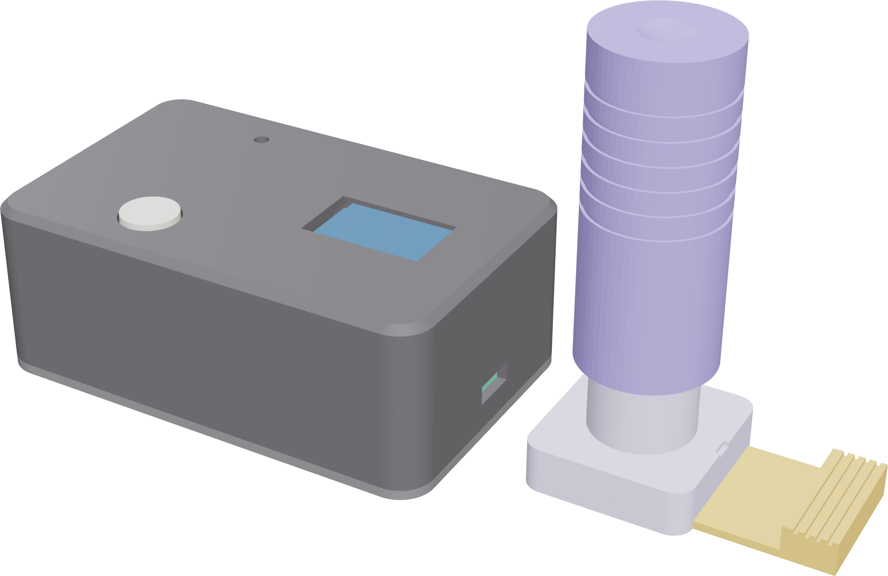

---
# 🧩 Versioning – systém dopĺňa automaticky
fm_version: "1.0.1"

# Dátum buildu – generuje skript
fm_build: "2026-11-02T15:50:53.673394+00:00"

# Poznámka k verzii – voliteľné
fm_version_comment: ""

# 🆔 IDENTITY --------------------------------------------------------

# ID generuje CLI / skript

# Unikátne UUID – generuje skript
guid: "e299986b-b8b4-490c-a8e6-3890a6494348"

# 🧭 CONTEXT ---------------------------------------------------------

# DAO / doména (knife, sdlc, q12, 7ds...) dopĺňa skript
dao: "sthdf"

# Názov zápisu – dopĺňa používateľ
title: "project outcomes"

# Krátky popis – dopĺňa používateľ (voliteľné)
description: "Stav a výstupy projektu Blotly"

# 👥 AUTHORSHIP ------------------------------------------------------

# Hlavný autor – z globálneho configu
author: "Viliam Vachan"

# Zoznam autorov – generuje skript
authors:
  - "Viliam Vachan"

# 🗂 CLASSIFICATION ---------------------------------------------------

# Nadradená kategória – môže doplniť používateľ
category: ""

# Typ dokumentu (guide, case, tutorial...) – používateľ (voliteľné)
type: ""

# Priorita (low/medium/high) – voliteľné
priority: ""

# Tagy – odporúča sa 2–6 tagov.
# Typy tagov:
#   - rámce: knife, 7ds, sdlc, q12
#   - účel: tutorial, guide, pattern, case-study
#   - téma: git, backup, ai, communication
#   - úroveň: beginner, intermediate, advanced
tags: ["sthdf","blotly"]

# 🌍 LOCALIZATION -----------------------------------------------------

# Jazyk dokumentu – doplní skript podľa štruktúry
locale: "sk"

# 🕒 LIFECYCLE --------------------------------------------------------

# Dátum vytvorenia – generuje skript
created: "2026-11-02 16:50"

# Dátum poslednej úpravy – dopĺňa človek
modified: "2026-11-02 17:30"

# Stav dokumentu – default "backlog"
status: "in-progress"

# Viditeľnosť – default "public"
privacy: "public"

# ⚖ INTELLECTUAL PROPERTY -------------------------------------------

# Držiteľ práv k obsahu – dopĺňa skript
rights_holder_content: "Viliam Vachan"

# Systémový vlastník práv
rights_holder_system: "CAA / KNIFE / LetItGrow"

# Licencia
license: "CC-BY-NC-SA-4.0"

# Disclaimer
disclaimer: "Use at your own risk. Methods provided as-is; participation is voluntary and context-aware."

# Copyright
copyright: "© 2025 Roman Kazicka"

# 🔗 ORIGIN / PROVENANCE ---------------------------------------------

# Repozitár pôvodu
origin_repo: ""

# URL pôvodného repozitára
origin_repo_url: ""

# Commit pôvodu
origin_commit: ""

# Branch pôvodu
origin_branch: ""

# Systém pôvodu (CAA/KNIFE/STHDF…)
origin_system: "CAA"

# Pôvodný autor
origin_author: "Roman Kazicka"

# Importovaný zdroj
origin_imported_from: ""

# Dátum importu
origin_import_date: ""

# 🧱 RESERVED ---------------------------------------------------------

fm_reserved1: ""
fm_reserved2: ""
---

<!-- SDLC_INSTANCE_ID: PRJ-123-Blotly -->

# 📦 Project Outcomes

> Stav k 2. 11. 2026. Projekt je v štádiu návrhu a prípravy prototypu. Sekcie označené TODO sa doplnia po zostavení a testovaní.

## 🔖 Stav projektu
**Funguje (hotové):**
- Výber princípu merania (optické presvecovanie papierika).
- Parametrický 3D model všetkých dielov a vygenerované STL aj GLB náhľady.
- Výber súčiastok a dodávateľov.
- Produktový plagát Blotly.

**Nefunguje / chýba:**
- Zostavený fyzický prototyp, firmvér pre ESP32-C3, kalibrácia a testy.
- Model ešte nezohľadňuje všetky úpravy zo zoznamu súčiastok (pozri nižšie).

## 🧩 Výstupy podľa SDLC / V-modelu
1. **Business požiadavky:** lacný merač mastnoty vlasov pre bežného používateľa; otvorený a zostaviteľný doma.
2. **Top Level Architecture:** mikrokontrolér + LED + svetelný senzor + OLED + tlačidlo v svetlotesnej skrinke s kazetou na papierik.
3. **Solution Architecture:** ESP32-C3 (I²C zbernica zdieľaná senzorom a OLED), LED spínaná 2N2222, napájanie cez USB-C.
4. **Analysis:** porovnanie troch princípov (kapacitný, optický, kamerový) – zvolený optický.
5. **Design:** [`hardware/model.py`](https://github.com/Vilvac003/PRJ-123-Blotly/blob/main/hardware/model.py), STL v [`hardware/stl`](https://github.com/Vilvac003/PRJ-123-Blotly/tree/main/hardware/stl), GLB v [`hardware/glb`](https://github.com/Vilvac003/PRJ-123-Blotly/tree/main/hardware/glb).
6. **Implementation:** TODO – tlač dielov, zostavenie, firmvér.
7. **Verification & Testing:** TODO – referencia čistého papierika, papierik s jojobovým olejom, opakovateľnosť, svetlotesnosť.
8. **Operation:** TODO – návod na používanie a údržbu.

## 🏆 Finálny produkt
- Repozitár: [https://github.com/Vilvac003/PRJ-123-Blotly](https://github.com/Vilvac003/PRJ-123-Blotly)
- Plagát: [`poster/blotly.pdf`](https://github.com/Vilvac003/PRJ-123-Blotly/blob/main/poster/blotly.pdf)
- 3D náhľad zostavy a rozloženia: `poster/blotly-hero-assembled.png`, `poster/blotly-hero-exploded.png`
- Fotky/video/demo prototypu: TODO

## 🧭 Porovnanie s Project Summary
| Plán | Stav |
|------|------|
| Princíp a návrh | ✅ hotové |
| 3D model | ✅ hotové (treba doladiť, pozri nižšie) |
| Prototyp | ⏳ TODO |
| Firmvér a meranie | ⏳ TODO |
| Dokumentácia | 🔄 rozpracované |

**Známe úpravy modelu:** `model.py` počíta s TSL2591, kým nákupný zoznam s BH1750 (21×16 mm, vrecko je presne 21 mm); doplniť čiapočku tlačidla a prispôsobiť dĺžku pružiny (0,8×8,3×60 mm).

---

## Navigácia
- [↩️ Späť](../index.md)
